# Teaching a 1.5B reasoning model to play the Wikipedia game: what the data shows

Findings from GRPO training of DeepSeek-R1-Distill-Qwen-1.5B, through stage 3. Data as of 2026-11-10.

Every number comes from the project's held-out games and W&B training logs. Figures can be rebuilt with `uv run python scripts/make_findings_figures.py`.

## The short version

1. **Reinforcement learning fixed the model's biggest weakness.** Success went from 13.8% to 47.5% on the same 80 games. Stage 3 won 27 games the untrained model lost and lost none the untrained model won.
2. **The model mainly learned to answer validly, and much less to navigate.** Invalid answers fell from 73% to 25% on those games. An estimated 77% of the gain comes from validity. Among valid moves, the share that get closer to the target did not change (35% to 36%).
3. **Trained R1 is on par with an untrained Qwen 1.5B, not ahead of it.** Stage 3 scores 45.0% against 38.0% for greedy Qwen, which looks like a win. Qwen with the same sampling temperature as R1 scores 42.0%, leaving a gap of +3 points (p = 0.39).
4. **More than one click from the target, moves are only modestly better than chance, and by four clicks out they match it.** A random link gets closer 42% of the time at four or more clicks. Stage 3's valid moves do 44%.
5. **Hop 3 and hop 4 gains come from surviving longer.** Stage 3's move quality at those distances is not better than Qwen's.
6. **The kind of invalid answer has changed.** Stage 3 almost never names the unlinked target (2%), but hallucinated titles are now its largest error (9%).

## 1. Background

### The game

The agent starts on one Wikipedia article and must reach a target by clicking links. Each turn it sees the target's summary, the current page, the steps left and up to 200 link titles. It replies in this format:

```text
<think>reasoning</think><answer>{"title": "Next Article"}</answer>
```

The game runs on the offline **Wikispeedia** graph, with 4,604 articles and 119,772 links, so distances can be computed exactly. The rules are fixed:

- A game ends after 10 valid moves or 3 invalid answers. An invalid answer also ends the game once valid moves plus invalid answers reach 10.
- Pages cannot be revisited, and a page with no unvisited links ends the game.
- "Hop *k*" means the shortest path from start to target is *k* clicks.

### The two models

| Model | Role | Decoding on held-out games |
|---|---|---|
| **Qwen2.5-1.5B-Instruct** | Untrained baseline | Greedy, 256-token cap (also re-run sampled at T=0.6 for this report) |
| **DeepSeek-R1-Distill-Qwen-1.5B** | The model trained here | Sampled at T=0.6, 1024-token cap |

Both are scored with **lenient parsing**, which accepts a title written as bare or fenced JSON. Qwen was the first baseline. The project then switched to R1 on the idea that a reasoning model would follow the format better, without first measuring R1. Untrained R1 turned out to be far worse.

### How training works

Training uses **GRPO**, a policy-gradient method, through Hugging Face TRL with a small LoRA adapter (r=16) on the frozen base model. One training example is one game position. The model samples 8 answers, each is scored by replaying the move, and answers that beat their group's average are reinforced.

**The reward is per step, using the true shortest-path distance:**

| Answer | Reward |
|---|---|
| Valid move, closer to the target | +1 |
| Valid move, same distance | 0 |
| Valid move, farther away | -1 |
| Reaches the target | additional +1 |
| Every answer | -0.02 |
| Dead end | -0.2 |
| Invalid: real page, illegal move | -1.5 |
| Invalid: title does not exist | -1.75 |
| Invalid: unparseable | -2.0 |
| Invalid: cut off at the token cap | -2.25 |

Invalid answers are ranked because untrained R1 was almost always invalid. A single flat penalty would give every sampled answer the same score, which leaves nothing to learn from. Held-out games use a separate, simple reward: +1 success, -0.02 per answer, -0.1 per invalid answer.

### The training stages

| Stage | Steps | Token cap | Hops in training states | Mix: start / optimal / noisy | W&B run |
|---|---|---|---|---|---|
| 1b | 275 (after 25 in stage 1) | 1024 | 1-3 | 0.4 / 0.3 / 0.3 | `kkqk572s` |
| 2 | 300 | 512 | 1-3 | 0.4 / 0.3 / 0.3 | `sa7pbhpc` |
| 3 | 300 | 512 | **2-4** | **0.6 / 0.2 / 0.2** | `mg1m4f44` |

Each stage resumes from the previous adapter. "Start" states are fresh games, "optimal" are points along a shortest path, and "noisy" are points along a partly random walk. Stage 3's mix gives states about 22 / 31 / 26 / 21% at 1 / 2 / 3 / 4 moves from the target. In stages 1b and 2, 57% of states were one move away.

### How results were measured

All models play the same fixed **held-out games** that training never samples: 50 per hop for 200 in total. Untrained R1, stage 1b and stage 2 played only the first 20 per hop, for 80 games.

Because models share games, they are compared **game by game**, using:

- an exact McNemar test, which looks only at games one model won and the other lost;
- bootstrap intervals for the difference;
- Holm correction when several tests are read together.

### Terms used below

| Term | Meaning |
|---|---|
| Closer / sideways / farther | Whether a valid move reduced, kept or increased the true distance |
| Closer (valid moves) | Share of valid moves that got closer, ignoring invalid answers |
| Closer by chance | Share of a page's unvisited links that would get closer |
| Lift | Closer (valid moves) divided by closer by chance. 1.0 means no better than random |

## 2. Results at a glance

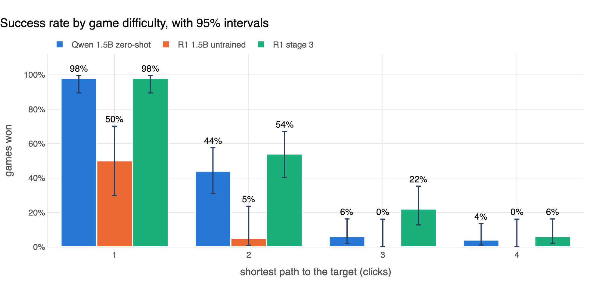

*Stage 3 matches Qwen at hop 1, and leads at hops 2 and 3 by margins within the error bars. Untrained R1 has only 20 games per hop, so its intervals are wide.*

| Agent | Games | Overall | Hop 1 | Hop 2 | Hop 3 | Hop 4 |
|---|---|---|---|---|---|---|
| Random | 200 | 1.5% | 6% | 0% | 0% | 0% |
| Qwen zero-shot, greedy | 200 | 38.0% | 98% | 44% | 6% | 4% |
| Qwen zero-shot, sampled (T=0.6) | 200 | 42.0% | 98% | 50% | 14% | 6% |
| R1 untrained | 80 | 13.8% | 50% | 5% | 0% | 0% |
| R1 stage 1b | 80 | 26.3% | 80% | 25% | 0% | 0% |
| R1 stage 2 | 80 | 35.0% | 80% | 40% | 20% | 0% |
| **R1 stage 3** | **200** | **45.0%** | **98%** | **54%** | **22%** | **6%** |

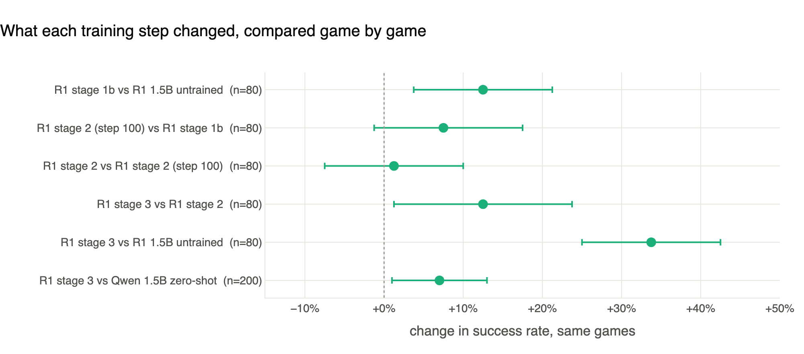

*Each dot is the change in success on games both models played, with its 95% interval. Only stage 3 against the untrained model survives correction for testing six comparisons together.*

| Comparison | Games | Success | Change [95% CI] | Won only by first / second | Exact p | Holm p |
|---|---|---|---|---|---|---|
| Stage 1b vs untrained | 80 | 26.3 vs 13.8% | +12.5 [+3.8, +21.3] | 13 / 3 | 0.021 | 0.106 |
| Stage 2 step 100 vs 1b | 80 | 33.8 vs 26.3% | +7.5 [-1.3, +17.5] | 11 / 5 | 0.21 | 0.42 |
| Stage 2 final vs step 100 | 80 | 35.0 vs 33.8% | +1.3 [-7.5, +10.0] | 8 / 7 | 1.00 | 1.00 |
| Stage 3 vs stage 2 | 80 | 47.5 vs 35.0% | +12.5 [+1.3, +23.8] | 16 / 6 | 0.052 | 0.157 |
| **Stage 3 vs untrained** | 80 | 47.5 vs 13.8% | **+33.8 [+25.0, +42.5]** | **27 / 0** | **<0.001** | **<0.001** |
| Stage 3 vs Qwen greedy | 200 | 45.0 vs 38.0% | +7.0 [+1.0, +13.0] | 27 / 13 | 0.038 | 0.154 |

## 3. Checking the raw notes

| # | Claim in the notes | Verdict | What the data says |
|---|---|---|---|
| 1 | Model learned to answer correctly: invalid down, format up | **Confirmed** | Invalid 62.5% to 23.6%. Think-and-answer format 0% to 96.8% |
| 2 | Qwen needed lenient parsing because it failed the format | **Clarify** | Lenient parsing rescued only 8.7% of Qwen's answers. R1 also uses it |
| 3 | Training increased extra steps on wins | **Partly** | 0.40 to 1.10 overall, but only +0.29 on games both won, and not significant |
| 4 | Naming the unlinked target fell from 47% to 2% | **Confirmed, reframed** | 48.4% to 2.3%, but untrained R1 was already at 0%, so this is a base-model difference |
| 5 | "Not an article title" tripled, so hallucinations rose | **Partly** | ×2.3 of all answers against Qwen. Within R1, training lowered it among answers that named a title |
| 6 | Other invalid causes were within noise | **Partly** | All four differ reliably, but each is small |
| 7 | Zero-shot fails early, stage 3 fails late | **Confirmed** | Median valid moves in failed games: 0 vs 7 |
| 8 | Stage 3 failures hit the step limit, earning negative reward | **Partly** | 20% are labelled step limit, but 52% used the full answer budget. There is no specific penalty |
| 9 | Wider reward distribution means exploring strategies | **Width yes, conclusion no** | The spread is entirely explained by game length |
| 10 | Thinking was shaped by the token budget | **Confirmed in stages 1-2** | Not in stage 3, where the cap no longer binds |
| 11 | Stage 3 beats Qwen at hop 3 (needs testing) | **Not significant** | 22% vs 6%, p = 0.057, corrected 0.23 |
| 12 | Hop 3 shows longer-horizon strategies | **Not supported** | Move quality at distance 3 is not better than Qwen's |
| 13 | Stage 3 vs Qwen is about +6% | **Correct to +7 points** | +7.0 vs greedy, +3.0 vs sampled |
| 14 | +34% vs untrained R1, and no reversals | **Confirmed** | +33.8 points, 27 / 0 |
| 15 | Hop 4 was too hard in training under the constraints | **Partly** | Training was flat, but cannot be pinned on hop 4. The token cap did not bind |
| 16 | Stage 3 much better than predecessors on held-out games | **Partly** | Overall yes, borderline. At hop 4, 1 of 20 vs 0 of 20 |
| 17 | Thinking became more efficient | **Confirmed** | 820 tokens to 132 across training |
| 18 | Closer rate, chance rate and final distance barely changed | **Confirmed** | 35.4 to 36.2%, 18.6 to 18.8%, 2.70 to 2.88 |
| 19 | 3-invalid, step-limit, one-click and got-closer metrics changed | **Mostly confirmed** | Three are clear, one-click is not significant at this size |
| 20 | Learned easy cases; far games now run out of steps | **Mostly confirmed** | Easy-case gain is clear. Most failures still end on invalid answers |
| 21 | Went from worse than Qwen to competitive or slightly better | **Competitive yes, better no** | Parity under equal decoding |

The sections below give the evidence for each.

### 3.1 Valid answers and format (claims 1, 2)

Over the 200 shared games, invalid answers fell from **62.5% to 23.6%** (change -38.8 points, 95% CI -44.6 to -33.1).

Format compliance moved from **0% to 96.8%**, but that gap is about reasoning. Qwen wrote an `<answer>` tag that parsed on 91.3% of answers and almost never wrote `<think>`. So Qwen's issue was less "cannot respond in the format" than "never reasons first."

Lenient parsing rescued 8.7% of Qwen's answers. It rescued 34% of untrained R1's answers and 0.6% of stage 3's, so all model evaluations benefit from it, and untrained R1 needed it most.

### 3.2 Detours on won games (claim 3)

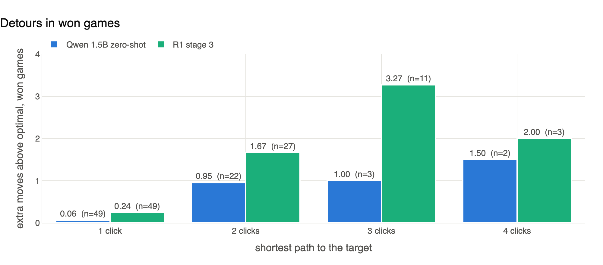

*Stage 3 wins with more detours at every hop, but the sample of Qwen wins past hop 2 is tiny.*

The rise from 0.40 to 1.10 extra moves is real, but part of it is about which games each model wins. Stage 3 wins more hard games, and hard games leave more room for detours.

The cleaner test uses the **63 games both models won**: Qwen 0.30, stage 3 0.59, difference +0.29 (95% CI -0.06 to +0.65, p = 0.14). The direction agrees with your note, but it is not significant.

The likely mechanism is survival. Qwen's games end quickly on invalid answers, so it can only win along nearly direct routes. Stage 3 lives long enough to recover from wrong turns.

### 3.3 What changed in the invalid answers (claims 4-6)

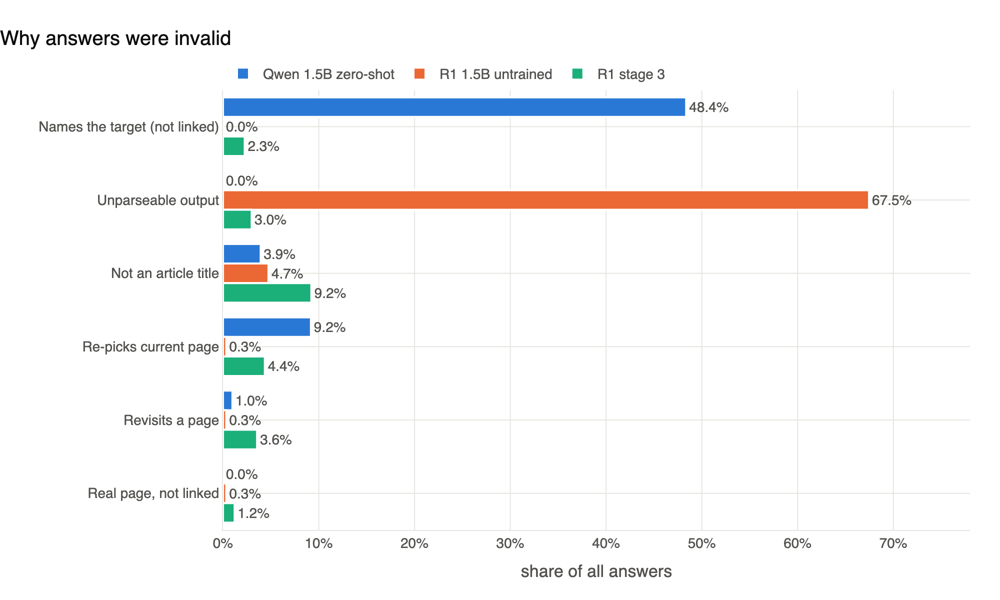

*Qwen's main failure was naming the unlinked target. Untrained R1's was unparseable output. Stage 3's largest remaining error is hallucinated titles.*

Share of all answers, Qwen versus stage 3 on 200 games:

| Cause | Qwen | Stage 3 | Change [95% CI] | Per game, Qwen → stage 3 |
|---|---|---|---|---|
| Names the target (not linked) | 48.4% | 2.3% | -46.1 [-53.4, -39.2] | 1.48 → 0.14 |
| Not an article title | 3.9% | 9.2% | +5.3 [+2.0, +8.4] | 0.12 → 0.57 |
| Re-picks current page | 9.2% | 4.4% | -4.8 [-8.7, -1.3] | 0.28 → 0.27 |
| Revisits a page | 1.0% | 3.6% | +2.6 [+0.9, +4.1] | 0.03 → 0.22 |
| Unparseable | 0.0% | 3.0% | +3.0 [+2.0, +4.0] | 0.00 → 0.19 |
| Real page, not linked | 0.0% | 1.2% | +1.2 [+0.7, +1.8] | 0.00 → 0.08 |

**Three corrections to the notes:**

- **Target naming is mostly a model difference.** Untrained R1 named the unlinked target 0% of the time and stage 3 does 3.1%, on the same 80 games. Comparing Qwen with stage 3 mixes the change of model with the effect of training. It is also not quite hallucination, because the target is a real page. Qwen is trying to jump straight there.
- **"Hallucinated titles tripled" depends on the baseline.** Against Qwen it rose ×2.3 as a share of answers, and ×4.75 per game because stage 3's games are longer. Within R1 the story reverses: untrained R1 named a title on only a third of its answers. Among answers that did name one, the hallucination rate *fell* from 14.6% to 10.5%. Training made R1 name far more titles, while making each one slightly less likely to be invented.
- **The other causes are small but not noise.** All four intervals exclude zero, so they are reliable differences of 1 to 5 points. Current-page errors are a useful reminder of denominators: they halve as a share of answers, but stay flat per game.

### 3.4 How games end (claims 7, 8)

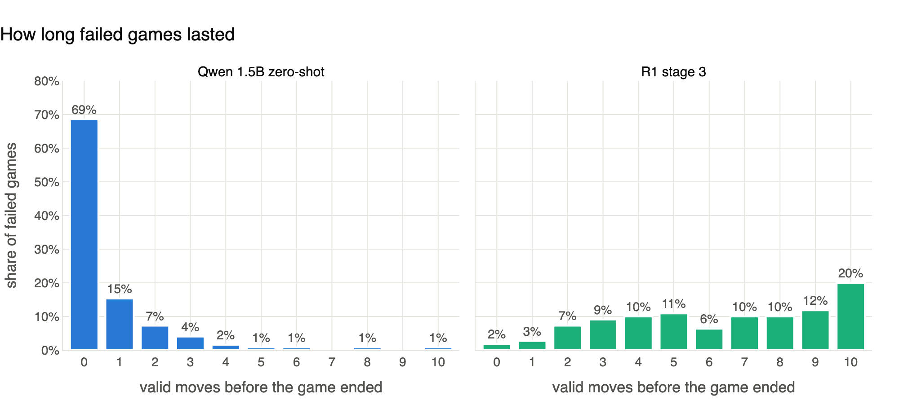

*Most of Qwen's failed games ended with no valid move at all. Stage 3's failed games last much longer.*

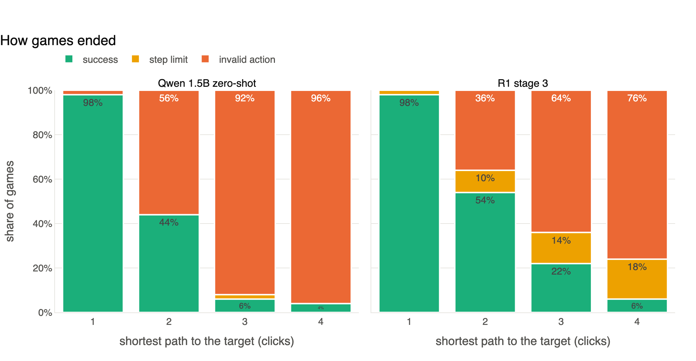

*The chart labels understate how many stage 3 games ran out of time, as explained below.*

| Failed games | Qwen greedy | Stage 3 |
|---|---|---|
| Count | 124 | 110 |
| Median valid moves | 0 | 7 |
| No valid move at all | 68.5% | 1.8% |
| 5 or more valid moves | 3.2% | 69.1% |
| Labelled "step limit" | 0.8% | 20.0% |
| Used 10 or more answers | 1.6% | 51.8% |

Your reading of the path-length chart is right, with one refinement: **"step limit" undercounts.** Only 22 of 110 stage 3 failures carry that label, because an invalid answer also ends the game once valid moves plus invalid answers reach 10. Such games are labelled "invalid action," and 18 of them ended with fewer than three invalid answers. Using the broader test, 52% of stage 3 failures used the full budget.

There is no specific penalty for hitting the step limit. The negative reward is only the -0.02 per answer.

### 3.5 Reward spread does not show exploration (claim 9)

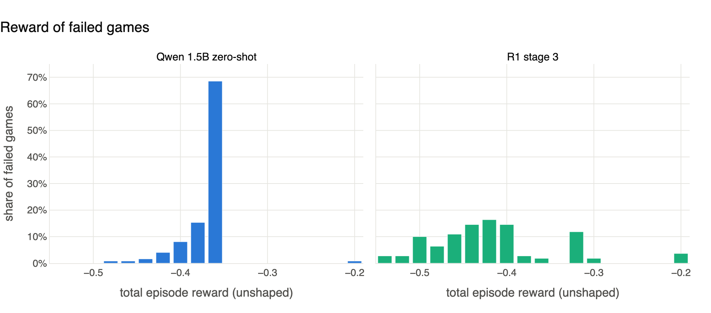

*Stage 3's failed-game reward spreads out because its games vary in length.*

The widening is real: standard deviation rose from 0.027 to 0.072 (Levene p < 0.001), and distinct reward values from 8 to 13.

It does not show new strategies. Failed-game reward in the held-out setup is an exact function of two counts:

> reward = -0.02 × valid moves - 0.12 × invalid answers

Those counts explain **100%** of the variance (R² = 1.00) for all three models. So the spread reflects longer and more varied game lengths, and reward at evaluation carries no information about strategy.

Testing exploration would need the variety of answers from the same position, across models at the same temperature. A small probe found stage 3 giving about 2 distinct valid answers per 3 samples, but with no baseline to compare.

### 3.6 Thinking length and the token budget (claims 10, 17)

I read "shared by the token budget" as "shaped by."

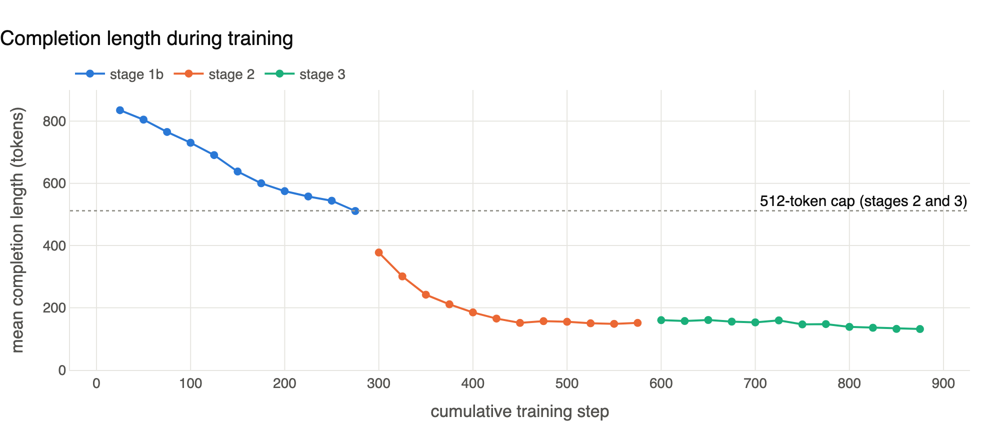

*Completion length falls steadily, then settles well below the cap.*

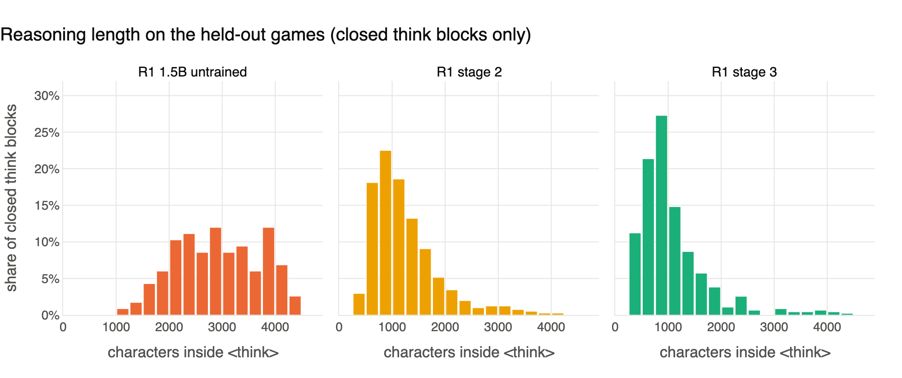

*Reasoning gets shorter on held-out games, even though every evaluation allowed 1024 tokens.*

| Stage | Cap | Completion tokens, first → last 50 steps | Cut off at cap, first → last 50 | Median think characters (held-out) |
|---|---|---|---|---|
| Untrained | - | - | - | 2,938 |
| 1b | 1024 | 820 → 528 | 49% → 12% | 2,348 |
| 2 | 512 | 339 → 150 | 22% → 0.6% | 1,079 |
| 3 | 512 | 159 → 132 | 0.6% → 0.1% | 904 |

The budget clearly shaped stages 1b and 2, and the concision persists even at evaluation, where the cap is 1024. By stage 3 the model uses about a quarter of the 512-token allowance, so the budget has stopped being a constraint.

Untrained R1 closed its think block on only 40% of answers, so its median describes the runs that finished.

Stage 3's valid and invalid answers use similar think lengths (medians 879 and 843 characters), so length alone does not distinguish them.

### 3.7 Hop 3 and the long-horizon claim (claims 11, 12)

Here is the requested hypothesis test.

| Hop | Stage 3 | Qwen greedy | Won only by stage 3 / Qwen | Exact p | Holm p (4 hops) |
|---|---|---|---|---|---|
| 1 | 98% | 98% | 1 / 1 | 1.00 | 1.00 |
| 2 | 54% | 44% | 13 / 8 | 0.38 | 1.00 |
| 3 | **22%** | **6%** | **11 / 3** | **0.057** | **0.23** |
| 4 | 6% | 4% | 2 / 1 | 1.00 | 1.00 |

The hop 3 gain is the largest of the four, +16 points (95% CI +2 to +30), but it **does not reach significance**. Greedy lenient Qwen is also the weakest of the five Qwen variants at hop 3 (6%, against 10%, 12%, 10% and 14%). Against the sampled variant the gap is 22% vs 14% (8 / 4 games, p = 0.39).

Longer-horizon strategy is not what the data shows. See [section 4.3](#43-past-one-click-moves-are-weak): at 3 clicks out, stage 3's valid moves get closer 27% of the time, compared with Qwen's 38%, and its lift over chance is lower (1.33 vs 1.54). Stage 3 wins more hop 3 games because it **stays in the game long enough**.

### 3.8 Against Qwen, and against itself (claims 13, 14, 21)

| Comparison (200 games) | Stage 3 | Other | Change [95% CI] | Only stage 3 / other | Exact p |
|---|---|---|---|---|---|
| Qwen strict, greedy | 45.0% | 33.5% | +11.5 [+4.5, +18.5] | 37 / 14 | 0.002 |
| Qwen lenient, greedy | 45.0% | 38.0% | +7.0 [+1.0, +13.0] | 27 / 13 | 0.038 |
| Qwen strict + feedback, greedy | 45.0% | 38.5% | +6.5 [0.0, +13.0] | 28 / 15 | 0.066 |
| Qwen lenient + feedback, greedy | 45.0% | 42.0% | +3.0 [-3.0, +9.0] | 21 / 15 | 0.41 |
| Qwen lenient, sampled T=0.6 | 45.0% | 42.0% | +3.0 [-2.5, +8.5] | 20 / 14 | 0.39 |

The note's "+6%" should be **+7.0 percentage points** against the lenient greedy baseline.

- The gain over the R1 baseline holds: **+33.8 points** (95% CI +25.0 to +42.5) on 80 games, with **27 / 0** reversals. Untrained R1 won only 11 of those 80 games, 10 of them at hop 1. "No regressions" is accurate, but a sample of 11 easy wins is a small basis for "robust."
- The note's framing that the Qwen comparison is pessimistic is fair. Untrained R1 was 25 points behind Qwen on the same 80 games (13.8% vs 38.8%, 21 / 1, p < 0.001).
- "Competitive" is well supported. "Slightly better, statistically" is not. The +7 result is significant only without correction (Holm p = 0.154), and it shrinks to +3 when Qwen uses the same sampling temperature.

### 3.9 The hop 4 training stage (claims 15, 16)

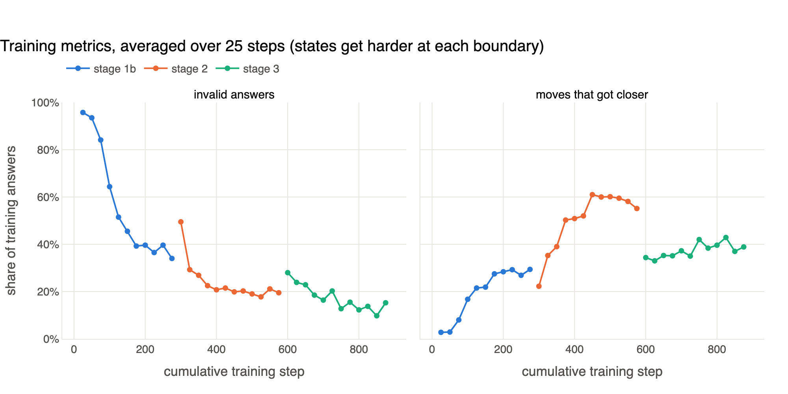

*Validity keeps improving through stage 3, while the closer rate barely moves. Each stage boundary changes the training states, so jumps there are not learning.*

Stage 3 was indeed the first to include hop 4. Within stage 3, comparing the first and last 50 steps:

| Metric | First 50 | Last 50 | Change [95% CI] |
|---|---|---|---|
| Invalid rate | 25.9% | 12.5% | -13.4 [-17.7, -9.2] |
| Closer rate | 33.7% | 37.9% | +4.3 [-3.3, +11.8] |
| Per-step success | 19.7% | 16.4% | -3.3 [-10.5, +4.0] |

Three refinements:

- **The struggle cannot be pinned on hop 4.** The logs do not split metrics by hop, and only about 21% of stage 3 states were four moves away.
- **The token cap was not one of the binding limits.** Under 1% of answers were cut off. The binding limits were 3 invalid answers and the 10-answer budget: at hop 4, 38 of 47 failed games ended on the invalid-answer rule.
- **The held-out gain is real overall but thin at hop 4.** Stage 3 scored 47.5% against stage 2's 35.0% on the same games (p = 0.052). At hop 4 it is 1 of 20 against 0 of 20, and 3 of 50 in the full set. Your "same dynamic in the closer metric" appears in training, but held-out closer rate also stayed flat (next section), so stage 3's gain did not come from better moves.

### 3.10 Failure behaviour (claims 18-20)

Untrained R1 against stage 3, on the same 80 games:

| Metric | Untrained (69 failed) | Stage 3 (42 failed) | Reading |
|---|---|---|---|
| Closer (valid moves) | 35.4% | 36.2% | Unchanged |
| Closer by chance | 18.6% | 18.8% | Unchanged |
| Failed games: final distance | 2.70 | 2.88 | Unchanged |
| Failed games ended on invalid answers | 100% | 81% | Changed (p < 0.001) |
| Failed games at step limit | 0% | 19% | Changed (p < 0.001) |
| Failed games: one click away at the end | 10.1% | 2.4% | Direction only (p = 0.25) |
| Failed games: ever got closer | 18.8% | 73.8% | Changed (p < 0.001) |

Your conclusion holds up well, with one adjustment. The easy-case learning is clear:

- At hop 1, success went from 10 of 20 to 20 of 20.
- At hop 2, from 1 of 20 to 13 of 20.
- At one click from the target, closer (valid moves) rose from 42% to 85%.

Failures now concentrate far from the target: over the 200 games, stage 3 failed 1 game at hop 1, 23 at hop 2, 39 at hop 3 and 47 at hop 4. The adjustment is the ending itself. Most failures still end on the invalid-answer rule, though about half use the full answer budget.

Drift shows up too: 39% of stage 3's failed games ended farther from the target than their closest point, up from 15% for untrained R1. Longer games give more time to wander.

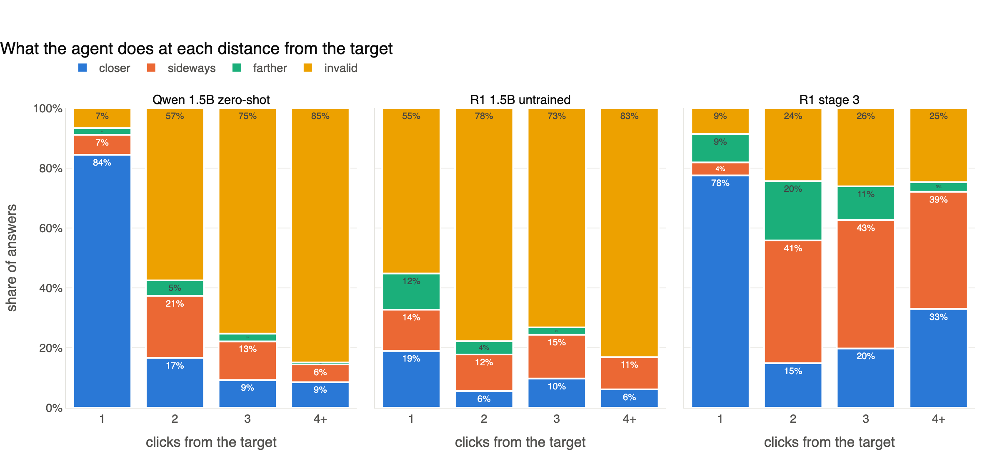

*Yellow invalid answers shrink sharply after training. In stage 3 the freed-up share goes mostly to sideways and farther moves except at one click out.*

## 4. Independent findings

### 4.1 Greedy decoding was holding Qwen back

Qwen's baseline used greedy decoding, so after an invalid answer it receives a nearly identical prompt and tends to repeat itself. In the greedy run, 57% of its invalid answers repeat the previous answer, against 3.8% for stage 3.

I re-ran Qwen on the same 200 games at T=0.6, the temperature R1 uses in evaluation:

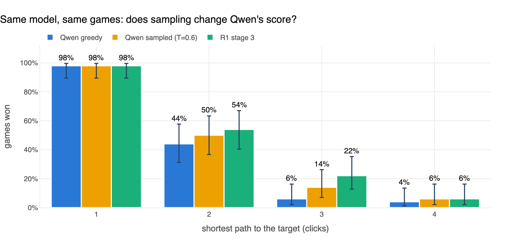

*Sampling lifts Qwen at hops 2 to 4, reducing the distance to stage 3.*

Sampled Qwen won **42.0%** (84 of 200), a +4.0 change from greedy (95% CI -0.5 to +8.5, p = 0.13). It is one seed, and the run has not been logged to W&B, but the point is about fairness: the two models should be compared at equal decoding. Stage 3's 45.0% is then **+3.0 points** (p = 0.39).

### 4.2 About three quarters of the gain is validity

I built a simple simulator: at each distance, an agent draws closer, sideways, farther or invalid from its measured frequencies, under the game's real limits. It reproduces overall results closely:

| Agent | Actual | Simulated |
|---|---|---|
| Qwen greedy | 38.0% | 39.1% |
| R1 untrained | 13.8% | 13.7% |
| R1 stage 2 | 35.0% | 35.9% |
| R1 stage 3 | 45.0% | 45.5% |

It is less accurate per hop, predicting 16% at stage 3's hop 4 where 6% happened, so these estimates are useful for the overall picture only.

Swapping only the invalid rate or only the move quality between untrained R1 and stage 3 splits the gain (averaged over the swap order):

| Source of gain | Points | 95% CI |
|---|---|---|
| Better validity | +25.8 | +16.9 to +34.3 |
| Better move quality | +7.5 | -2.3 to +18.1 |

**About 77% of the improvement comes from answering validly**, and the move-quality interval includes zero.

### 4.3 Past one click, moves are weak

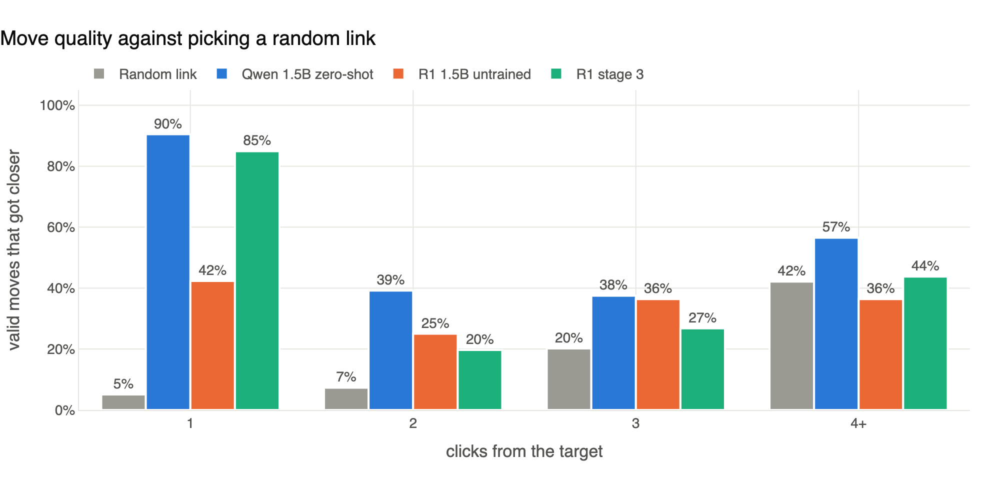

*Stage 3 is strong at one click out, then close to chance by four clicks out. Qwen's bars rest on far fewer valid moves at longer distances.*

| Clicks from target | Random link | Stage 3 | Stage 3 lift | Qwen greedy | Valid moves (stage 3 / Qwen) |
|---|---|---|---|---|---|
| 1 | 5% | 85% | 16.7× | 90% | 106 / 84 |
| 2 | 7% | 20% | 2.7× | 39% | 264 / 74 |
| 3 | 20% | 27% | 1.3× | 38% | 366 / 48 |
| 4+ | 42% | 44% | 1.0× | 57% | 208 / 23 |

At distance 2, Qwen's valid moves are better than stage 3's (39% vs 20%, Fisher p = 0.001). This comparison has an important caveat: Qwen only produces a valid answer on 43% of those turns, likely the cases where it is most confident. So this does not prove Qwen navigates better in general. It does show that stage 3's extra valid answers are not better-quality moves.

The reasoning text gives some flavour. Stage 3 went from Spain to Augustus when heading for Friedrich Nietzsche, and claimed "the UK was involved" in the September 11 attacks. On Cape Town it reasoned that clicking Cape Town itself would reach the target. It writes fluent justification without real knowledge of the graph.

### 4.4 Fixing navigation has more room than fixing validity

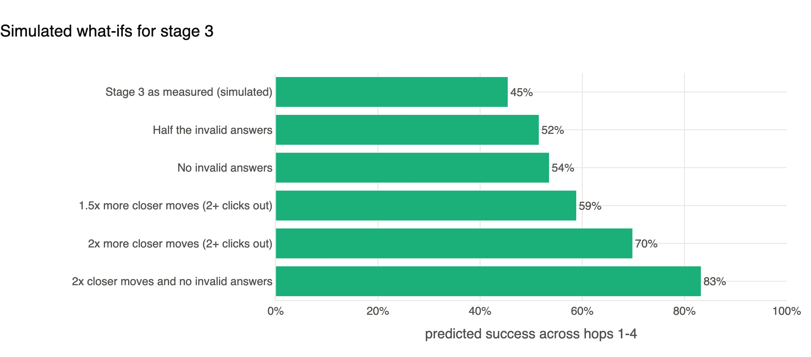

*Each bar is a simulated change to stage 3's measured behaviour. The "2×" scenarios are illustrative sizes, not forecasts.*

Removing every invalid answer takes simulated success from 45.5% to 53.5%, a gain of about 8 points. Doubling the closer rate at two or more clicks out takes it to 69.8%, about 24 points. Validity has been the main source of gain so far, but much less of it remains.

### 4.5 Sample sizes needed

Models that differ by the observed amount split about 27.5% of games. At 80% power and p < 0.05:

| Change to detect | Paired games needed |
|---|---|
| 5 points | about 860 |
| 10 points | about 214 |
| 15 points | about 94 |

Today's 200-game evaluation can detect about a 10-point change. Confirming a 7-point gap would take about 440 games, so smaller claims need more games or repeated seeds.

### 4.6 Training metrics do not transfer across stages

Stage 2's closer rate reached about 57% while stage 3's was about 38%, yet stage 3 is the better model. Stage 3's states were harder. Per-step success was flat through stage 3, while held-out success rose by 12.5 points. **Training curves are comparable within a stage only.**

### 4.7 Popular targets may be easier

After controlling for hop, each doubling of a target's incoming links raised stage 3's odds of winning by 1.26× (95% CI 0.97 to 1.63, p = 0.08). The estimate is similar for Qwen (1.22×), and neither is significant, so treat this as a lead rather than a result.

### 4.8 Cost

Stage 3 and its evaluation cost about **$4.04** of GPU time (7.09 hours at $0.57/hour). Training through stage 3 used about 16 GPU-hours in total. On a Mac, stage 3 takes about 11.5 seconds per answer against 1.2 for Qwen, roughly 10× more compute per decision, to reach parity.

### 4.9 Hands-on probe

On 12 real mid-game positions from harder games, answering 3 times each:

| Setup | Invalid | Closer | Sideways | Farther |
|---|---|---|---|---|
| Stage 2, T=0.6 | 56% | 19% | 19% | 6% |
| Stage 3, T=0.6 | 25% | 22% | 36% | 17% |
| Stage 3, T=0.2 | 19% | 31% | 42% | 8% |
| Stage 3, T=1.0 | 22% | 33% | 36% | 8% |

With 36 answers per row, this is illustrative. It agrees with the main results: stage 3 is much more often valid than stage 2, but not more often closer. Temperature shows no clear pattern.

## 5. What the design decisions explain

Each row links a project decision (full records in [`docs/decisions/`](../decisions/README.md)) to what the data now suggests. None of these was tested with an ablation, so causes are plausible readings and not proven.

| Decision | Why it was made | What the data suggests |
|---|---|---|
| Switch from Qwen to R1 before measuring R1 ([ADR-0009](../decisions/0009-switch-to-r1-distill-qwen-1-5b.md)) | Hoped a reasoning model would follow the format | Untrained R1 was 25 points worse. Most of training then paid off that deficit |
| Per-step reward with true distance ([ADR-0010](../decisions/0010-per-step-progress-shaped-reward.md)) | Whole-game reward is too sparse for a weak model | Gives signal from step one. It rewards a good move without giving the model any way to know which link is closer |
| Ranked invalid penalties, no supervised warm start ([ADR-0011](../decisions/0011-ranked-invalid-rewards-no-warm-start.md)) | Cold start: nearly all output was invalid | Validity improved strongly, which fits this design |
| Completion cap 1024 then 512 ([ADR-0014](../decisions/0014-completion-cap-curriculum.md)) | Room to learn the format, then force concision | Cut-offs fell to under 1% and steps got faster. The cap had stopped mattering by stage 3 |
| Mixed states, easy-skewed in stages 1-2 ([ADR-0013](../decisions/0013-mixed-training-state-distribution.md)) | Cover starts and mid-game, cheaply | 57% one-move states fits the strong one-click skill and inflated training success |
| Stage 3 shift to hops 2-4 ([ADR-0023](../decisions/0023-stage-3-harder-training-states-on-runpod.md)) | Train where the model fails | Coincides with the +12.5-point gain, mostly through validity rather than navigation |
| Shared held-out pool with exact per-hop pairs ([ADR-0005](../decisions/0005-heldout-evaluation-protocol.md)) | Honest comparisons | It is what makes game-by-game testing possible at all |

**Why might navigation have plateaued?** These are hypotheses to test, not findings:

- Choosing a link two or more clicks ahead needs knowledge of how articles connect, which a 1.5B model may lack.
- Each state is rewarded independently, so nothing directly teaches planning.
- "Noisy" training states only approximate the model's own mistakes.
- By the end of stage 3, 26% of sampled groups had no reward difference at all, so they provided no learning signal.

## 6. Limitations

- **One attempt per game.** Sampling luck and real skill cannot be separated. Sampled Qwen uses one seed.
- **Uneven samples.** Stages before 3 and untrained R1 have 80 games, so most stage-to-stage steps are too small to confirm.
- **Settings still differ.** Qwen's cap is 256 tokens and R1's 1024. Only the temperature was equalised here.
- **No ablations.** Ranked vs flat penalties, shaped vs whole-game reward and the token curriculum were never tested individually.
- **Conditional move quality.** Per-distance numbers cover states each agent actually reached, and valid moves are a selected subset, especially for Qwen.
- **Simulation.** It assumes each answer depends only on distance, and overstates hop 4.
- **One graph.** Wikispeedia is small, so results may not carry over to full Wikipedia.

## 7. What this suggests next

- Compare at equal decoding, and log the sampled Qwen run to W&B if it should appear on the app's Baselines page.
- Evaluate at 50 per hop for every stage worth comparing, ideally with more than one seed.
- Target navigation at two or more clicks: this is where the largest remaining gain sits.
- Target hallucinated titles, now the largest single error.
- Log training metrics per distance, so a stage's difficulty can be separated from learning.
- Run at least one ablation, starting with flat vs ranked penalties, which is already a flag.

## Appendix: figure index for the blog

| File | Shows | Suggested use |
|---|---|---|
| `01_success_by_hop.png` | Success by hop, three agents | Headline result |
| `02_paired_comparisons.png` | Game-by-game changes | Rigour of the stage comparison |
| `03_invalid_causes.png` | Invalid answers by cause | How errors changed |
| `04_failed_game_length.png` | Length of failed games | Early vs late failure |
| `05_how_games_end.png` | Endings per hop | Failure modes |
| `06_failed_game_reward.png` | Failed-game reward | Spread comes from game length |
| `07_reasoning_length.png` | Think length on held-out games | Learned concision |
| `08_training_completion_length.png` | Completion length through training | Effect of the token cap |
| `09_training_invalid_and_closer.png` | Invalid and closer rates | Validity learned, navigation flat |
| `10_distance_outcomes.png` | Outcomes by distance, three agents | The central behaviour chart |
| `11_move_quality_vs_chance.png` | Move quality against random | Weak long-range navigation |
| `12_extra_steps.png` | Detours in won games | Efficiency |
| `13_counterfactuals.png` | What-if scenarios | Where the remaining gain is |
| `14_qwen_decoding.png` | Greedy vs sampled Qwen | Why fair decoding matters |
